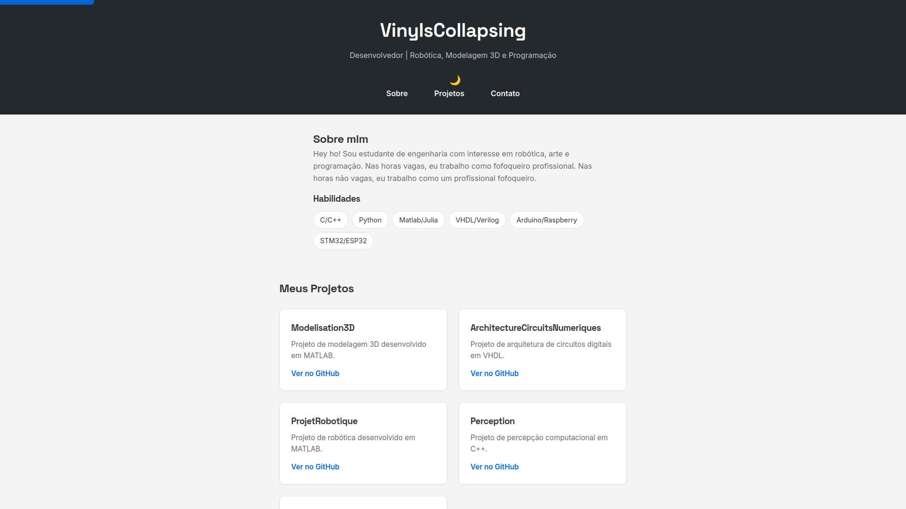

# Portfólio Pessoal

Meu portfólio de projetos, para aprender uma nova habilidade ele foi desenvolvido do zero com HTML, CSS e JavaScript.

**[Acesse o site](https://vinyIsCollapsing.github.io)**



## Tecnologias


## Funcionalidades (até o momento)

- Design responsivo (mobile-first)
- Tema claro/escuro com persistência (`localStorage`)
- Menu hambúrguer em telas pequenas
- Animações de entrada dos cards com `IntersectionObserver`
- Navegação por âncoras com scroll suave
- Acessibilidade (skip link, foco visível, ARIA labels)

## Rodar localmente

```bash
git clone https://github.com/vinyIsCollapsing/vinyIsCollapsing.github.io.git
cd vinyIsCollapsing.github.io
# abra index.html no navegador (ou use Live Server no VS Code)